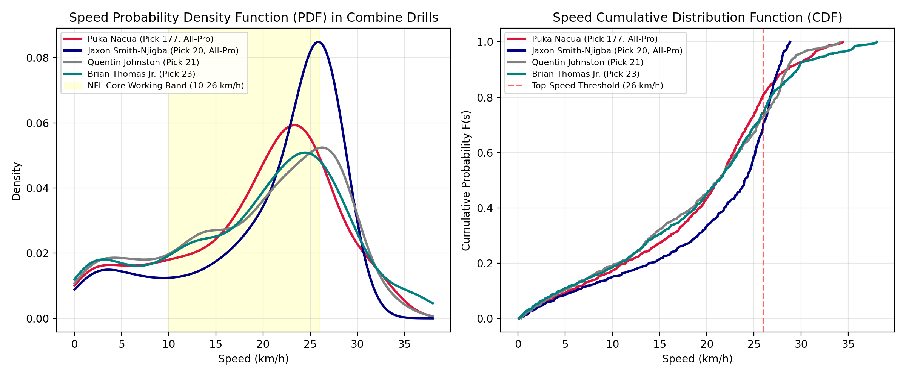
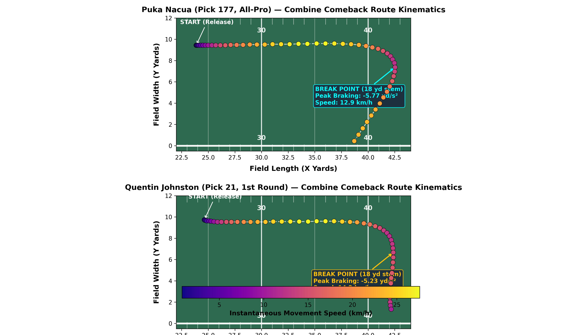

# NFL Big Data Bowl 2027: The Velocity Corridor Hypothesis

> **Uncovering non-obvious linkages between 10 Hz Combine sensor tracking and regular-season NFL game performance using frequentist kinematics.**

[](LICENSE)
[](https://www.python.org/)

---

## 🏈 Executive Overview

Traditional NFL scouting over-indexes on the final stopwatch numbers from physical testing—most notably the 40-yard dash. However, regular-season NFL games rarely feature players sustaining top sprint speeds above 30 km/h (18.6 mph). 

This research project introduces the **Game-Relevant Velocity Corridor (GRVC)** hypothesis:
1. **The Operating Window:** Over 90% of in-game offensive and defensive movements occur in the sub-maximal **10–26 km/h (6–16 mph)** velocity corridor.
2. **Distributional Kinematics over Stopwatches:** A prospect's continuous **Speed Probability Density Function (PDF)** and **Braking Deceleration Slope** ($\frac{ds}{dt}$) during Combine route drills explain regular-season separation better than top-end sprint tails.
3. **The Proof Point:** 5th-round steal and 1st-Team All-Pro **Puka Nacua** spent **63.5%** of his Combine tracking frames in the core operating corridor with an elite peak braking rate of **-5.77 yd/s²**, while 1st-round track stars with higher top speeds exhibited wider turning arcs and lower in-cut deceleration efficiency.

---

## 📊 Visualizations

### 1. Speed PDF & CDF Comparison (Combine Drills)
Comparing All-Pros (Puka Nacua, Jaxon Smith-Njigba) against 1st-round track athletes:


### 2. Publication-Grade Comeback Route Kinematics
Side-by-side field tracking comparison mapping instantaneous speed and break point mechanics on regulation turf:


### 3. Interactive 10 Hz Trajectory Playback
An interactive HTML route visualizer with play/pause controls and time scrubbing is located in `docs/index.html` (viewable on GitHub Pages).

---

## 🛠 Project Structure

```text
nfl-big-data-bowl-2027/
├── .gitignore                   # Ignores data/ and CSVs (CC BY-NC 4.0 compliant)
├── README.md                    # Project motivation, methodology & findings
├── requirements.txt             # Python environment dependencies
│
├── src/
│   ├── compare_wr.py            # Route drill deceleration and braking metrics
│   ├── inspect_positions.py     # Multi-position performance & honors audit
│   ├── create_static_field_plot.py # Publication-grade Matplotlib field visualizer
│   └── create_interactive_playback.py # Plotly 10 Hz time-scrubber animation
│
├── figures/                     # High-res publication graphics
│   ├── wr_speed_pdf_cdf.png
│   └── route_kinematics_field_plot.png
│
└── docs/                        # Web assets & GitHub Pages interactive viewer
    └── index.html               # Standalone interactive Plotly HTML
```

---

## 🚀 Setup & Replication

### 1. Install Dependencies
```bash
git clone https://github.com/13emerald4/nfl-big-data-bowl-2027.git
cd nfl-big-data-bowl-2027
pip install -r requirements.txt
```

### 2. Dataset Access (Kaggle)
Per Kaggle rules, competition data cannot be redistributed. Download the dataset directly from Kaggle:
```bash
kaggle competitions download -c nfl-big-data-bowl-2027 -p data/
unzip data/nfl-big-data-bowl-2027.zip -d data/
```

### 3. Generate Visuals
```bash
python src/create_static_field_plot.py
python src/create_interactive_playback.py
```

---

## 📜 Citation & License
Competition data provided by the National Football League under [CC BY-NC 4.0](https://creativecommons.org/licenses/by-nc/4.0/). Code and analysis are released under the open-source MIT License.
