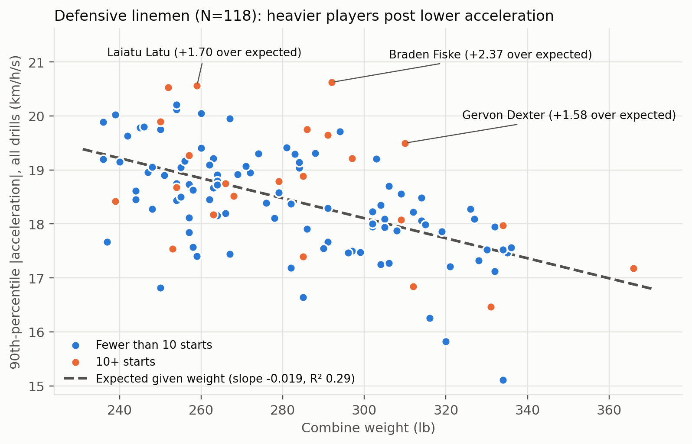

# Beyond the Stopwatch, Behind the Draft Board: What Combine Tracking Adds Once Draft Position Is Known

**Author:** Michael Polley  
**Track:** NFL Big Data Bowl 2027 (Kaggle Analytics Track)  
**Code:** every number below is printed by `scripts/run_regressions.py`, `scripts/rank_predictors.py` and `scripts/game_speed_distribution.py` (outputs in `results/`).

---

## 1. The question a front office actually faces

Combine sensor tracking records how a prospect moves through every drill at 10 Hz, not just how long a sprint took. The obvious test is whether those movement metrics predict NFL careers. They appear to. Among 96 receivers with a 40 time, each extra km/h of median speed in cutting drills goes with **+114 career snaps** (p = 0.002). Mass-adjusted acceleration in defensive linemen goes with **1.85× the odds of becoming a starter** (p = 0.042).

Those correlations answer the wrong question. Teams play the players they invested in, so playing time follows draft slot. A scout needs to know whether a prospect will play **more than his draft slot already predicts**. So every model here is fit twice: once on the Combine metric alone, and once adding the prospect's draft pick (log scale), an undrafted flag and draft-class fixed effects for seasons of exposure (plus position fixed effects for linemen and defensive backs).

**Finding.** The four tracking metrics behind the usual "movement beats the stopwatch" claims (receiver cut speed, defensive-line and offensive-line mass-adjusted acceleration, defensive-back break speed) each show a significant raw link to playing time. **None of them survives the draft controls.** Draft position alone explains 51% of the variance in receiver snaps, and the tracking metrics add 0.2 percentage points. A ranking of every available predictor gives the same order for playing time: draft pick, then NGS scores, with nothing adding to pick. Combine information shows up only in **per-snap efficiency**: drill-standardised cut speed for receivers, and short-area speed (10-yard split, 40 time) for pass rushers. These leads are worth a pre-registered test on the 2026 class, not a draft rule today.

---

## 2. Data and definitions

The cohort is 510 prospects drafted or signed in 2023–2025. Combine tracking supplies 10 Hz position, speed `s` and acceleration magnitude `a` for each drill rep. Outcomes are career snaps and starts through 2025, plus per-snap efficiency computed from `player_play.csv`. **Regular-season snaps only**: 249,269 of the file's 314,197 rows; the rest are preseason and playoffs.

| Group | Combine metric | N | Efficiency outcome |
|:--|:--|:-:|:--|
| WR | Median speed in curl, comeback, speed-out, slant ($s_{\text{cut}}$, km/h) | 106 (96 with a 40) | Yards per route run, targets per route, separation at the throw |
| WR | Drill-standardised cut speed ($z_{\text{cut}}$): per-drill median, z-scored within drill, averaged | 106 | same |
| DL | $\gamma_{\text{OE}}$: 90th-percentile acceleration residualised on weight (all drills, or pass-rush drill) | 118 | Pressure rate, get-off time |
| DB | 90th-percentile speed in the 45° back-pedal transition drill | 101 | — |
| OL | $\gamma_{\text{OE}}$ in the mirror and wave drills | 95 | — |

Two definitions needed fixing before testing:

* **Drill mix.** Prospects did not run the same drills. Jaxon Smith-Njigba's tracked cutting work is only the slant and the speed out. A pooled median across all his drills, including the gauntlet, gives 24.0 km/h; his cutting-drill median is 19.6 km/h. $z_{\text{cut}}$ compares each player only with others who ran the same drill.
* **Acceleration is a magnitude.** `a` is never negative, so its 90th percentile counts hard braking as well as burst. Pooled over every drill, $\gamma$ also rises with the number of drills a lineman ran (r = 0.36). The pass-rush drill, which all 118 linemen ran, gives a like-for-like version.

---

## 3. Game speed context

Across 18.1 million regular-season tracking frames, the **median speed is 6.8 km/h** (95th percentile 21.9 km/h). **66% of frames are below 10 km/h** and only 1.5% above 26 km/h, though 7.0% of player-snaps touch 26 km/h at some point. Football is mostly played at moderate speed, so movement through a cut is worth measuring.

---

## 4. Main result: the raw signal is the draft board


**Figure 1** shows each model's test statistic (coefficient ÷ standard error). Blue is the Combine metric alone and orange adds draft controls; the shaded band is not significant at 5%. Every volume outcome that starts outside the band moves into it.

| Metric → outcome | Metric alone | + draft controls |
|:--|:-:|:-:|
| WR $s_{\text{cut}}$ → career snaps (per km/h) | **+114, p = 0.002** | −10, p = 0.74 |
| WR $s_{\text{cut}}$ → starter, 10+ starts (odds ratio per km/h) | **1.63, p = 0.026** | 1.11, p = 0.76 |
| DL $\gamma_{\text{OE}}$ (all drills) → starter (odds ratio) | **1.85, p = 0.042** | 1.52, p = 0.35 |
| DB break speed → career snaps (per km/h) | **+192, p = 0.011** | −15, p = 0.80 |
| OL $\gamma_{\text{OE}}$ → career snaps | **+155, p = 0.015** | +58, p = 0.32 |

*OLS with heteroskedasticity-robust (HC1) standard errors; logit for starter status.*

**Why it collapses.** Teams already see what the sensors see. Receivers with faster cutting-drill speed are drafted earlier ($s_{\text{cut}}$ on log pick: p = 0.012), so cut speed and draft slot carry the same information. The tier split makes it concrete:

| WR tier (career starts) | N | Mean $s_{\text{cut}}$ | Mean draft pick (UDFA = 262) | Undrafted |
|:--|:-:|:-:|:-:|:-:|
| Top (20+) | 14 | 18.03 km/h | 62 | 0% |
| Middle (3–19) | 40 | 17.19 km/h | 116 | 10% |
| Fringe (0–2) | 52 | 16.53 km/h | 184 | 50% |

The raw tier gap is large (Welch t = 4.75, p < 0.001, Cohen's d = 1.00). But half the fringe tier went undrafted, and undrafted receivers rarely get starts whatever their cut speed. Within draft slot and class, cut speed does not separate starters from non-starters.

**Multiple testing.** The full design fits 22 controlled tests (`results/model_results.csv`). One falls below p = 0.05: DL $\gamma_{\text{OE}}$ (all drills) → career snaps, +85 per unit, p = 0.048. Chance alone predicts about one in 22. After Holm correction, none is significant.

---

## 5. What is left: two efficiency leads

Snaps measure opportunity. Per-snap efficiency is closer to talent, and the coaching staff's investment matters less there. Two leads stand out, both just short of significance:

1. **Receivers: drill-standardised cut speed → yards per route run.** +0.32 YPRR per unit of $z_{\text{cut}}$ (about 1 SD), p = 0.058, N = 57 receivers with 100+ routes, after draft controls. The pooled $s_{\text{cut}}$ shows nothing (p = 0.56). The definition fix is what exposes the lead.
2. **Defensive linemen: pass-rush-drill $\gamma_{\text{OE}}$ → starter.** Odds ratio 1.60, p = 0.059, after draft and position controls. Its link to pressure rate and get-off time is flat (p = 0.55 and 0.32), so the mechanism is unclear.

Separation at the throw, the in-game outcome closest to "cutting", shows no positive link. Raw pooled $s_{\text{cut}}$ is in fact slightly *negative* (−0.08 yd per km/h, p = 0.013), weakening to p = 0.16 after controls. Faster cutters are not measurably more open when the ball is thrown.

---

## 6. Which factors predict performance?

`scripts/rank_predictors.py` ranks every available predictor: draft slot, Combine results, NGS scores and the tracking metrics. Playing time is scored by cross-validated AUC for starter status (0.5 = coin flip; 5 folds × 20 repeats). Efficiency is scored by rank correlation after removing draft pick, plus edge vs interior for linemen.

| Outcome | 1st | 2nd | 3rd | Best tracking metric |
|:--|:--|:--|:--|:--|
| WR starter (AUC) | Draft pick 0.87 | NGS final score 0.78 | NGS college production 0.74 | Cut speed 0.69 |
| DL starter (AUC) | Draft pick 0.82 | NGS final score 0.76 | NGS college production 0.74 | Pass-rush $\gamma_{\text{OE}}$ 0.65 |
| DB starter (AUC) | Draft pick 0.90 | NGS final score 0.81 | NGS college production 0.76 | Break speed 0.63 |
| OL starter (AUC) | Draft pick 0.93 | NGS final score 0.86 | NGS college production 0.85 | $\gamma_{\text{OE}}$ 0.67 |
| WR yards per route run, beyond pick | **$z_{\text{cut}}$ +0.33 (p = 0.008)** | NGS college production +0.21 (p = 0.10) | NGS athleticism −0.19 (p = 0.15) | (1st) |
| DL pressure rate, beyond pick and position | NGS final score +0.36 (p = 0.003) | **10-yard split −0.29 (p = 0.034)** | Bench reps +0.29 (p = 0.10, N = 34) | $\gamma_{\text{OE}}$ +0.24 (p = 0.044) |

**Playing time.** Draft pick ranks first at every position, then the two NGS scores. Adding any other predictor to draft pick changes out-of-sample AUC by less than 0.01, apart from two noisy small-sample cases (DB bench reps, N = 43; DB 40 time). The NGS scores add nothing beyond pick either.

**Efficiency is where Combine measures carry information.** For receivers, drill-standardised cut speed is the only measure related to yards per route run beyond draft slot. For pass rushers, short-area speed matters at a given slot and position: the 10-yard split (−0.29) and 40 time (−0.28, p = 0.038), with faster rushers generating more pressure. The stopwatch the original framing dismissed is one of the better pass-rush signals.

These 30 efficiency correlations are exploratory. Seven fall below p = 0.05 where about 1.5 are expected by chance, but none survives Holm correction.

---

## 7. Case studies: what one rep can and cannot show

| Receiver | Pick | Starts | All-Pro 1st / Pro Bowls | $s_{\text{cut}}$ | $z_{\text{cut}}$ | Cutting drills run | YPRR |
|:--|:-:|:-:|:-:|:-:|:-:|:-:|:-:|
| Puka Nacua | 177 | 43 | 1 / 2 | 18.1 | +0.29 | 4 | 3.26 |
| Jaxon Smith-Njigba | 20 | 36 | 1 / 1 | 19.6 | +0.34 | 2 | 2.33 |
| Brian Thomas Jr. | 23 | 30 | 0 / 0 | 18.6 | +0.42 | 4 | 2.08 |
| Quentin Johnston | 21 | 31 | 0 / 0 | 16.9 | −0.12 | 4 | 1.43 |


Nacua, a Day-3 pick turned All-Pro, is the case to explain. His $z_{\text{cut}}$ is above average but below Thomas Jr.'s, so cut speed alone would not have flagged him.


On the comeback route (one rep each, **Figure 3**), the two enter the break almost identically:

* **Into the break:** stem peaks of 27.6 and 27.1 km/h, slowest points of 12.2 and 12.4 km/h.
* **Braking:** each sheds about 385–390 kg·m/s of momentum. Peak braking is −5.77 vs −5.23 yd/s².
* **Out of the break:** this is where they differ. One second after his slowest frame Nacua is back to **22.7 km/h**; Johnston is at **15.7 km/h** and slowing.
* **Shape:** the paths differ too. Nacua's rep breaks back toward the line of scrimmage; Johnston's turns closer to 90°.

Re-acceleration out of the break is a promising feature, but **a single rep per player is an anecdote**, not evidence.



**Figure 4** shows why mass adjustment matters: weight explains 29% of acceleration variance (−0.019 km/h/s per lb). Braden Fiske (+2.37), Laiatu Latu (+1.70) and Gervon Dexter (+1.58) sit well above expectation, and all became starters (24, 17 and 33 starts). They were also picks 39, 15 and 53, which is why $\gamma_{\text{OE}}$ adds little once draft slot is known.

---

## 8. How a front office should use this

1. **Don't read raw tracking-to-snaps correlations as evidence.** Draft slot explains 51% of receiver snap variance; adding cut speed raises it to 51.3%. Any metric must be tested *conditional on draft position*.
2. **Standardise within the drill.** Pooled medians mix drills a prospect did or did not run. A within-drill z-score is the minimum fix.
3. **Judge on per-snap efficiency, not volume.** Snaps and starts reflect the draft investment. YPRR, pressure rate and separation are the outcomes a Combine metric should move.
4. **For pass rushers, keep the stopwatch.** At the same draft slot and position, a faster 10-yard split goes with a higher pressure rate.
5. **Pre-register the leads on the 2026 class.** Fix the definitions now, then test once on the new class:
   * $z_{\text{cut}}$ → YPRR;
   * 10-yard split → pressure rate;
   * pass-rush-drill $\gamma_{\text{OE}}$ → starter.

   A confirmed effect would be the first Combine movement measure shown to add information beyond the draft board.

**Limitations.** Careers are one to three seasons long. Efficiency samples are small (57 receivers, 69 rushers). Each player has a single tracked rep per drill. And `a` cannot separate acceleration from braking.

---

## 9. Reproducing

```bash
python scripts/extract_features.py
python scripts/run_regressions.py   # writes results/
python scripts/rank_predictors.py
python scripts/game_speed_distribution.py   # NFL_BDB_ZIP=<zip> if not extracted
python scripts/make_field_plot.py
python scripts/make_interactive_playback.py
```

Interactive views: [`route_playback_interactive.html`](route_playback_interactive.html), [`tier_comparison_pdf_cdf.html`](tier_comparison_pdf_cdf.html), [`speed_pdf_cdf_interactive.html`](speed_pdf_cdf_interactive.html). Formal write-up: [`report_assigned.pdf`](report_assigned.pdf). Slides: [`presentation.pdf`](presentation.pdf).
