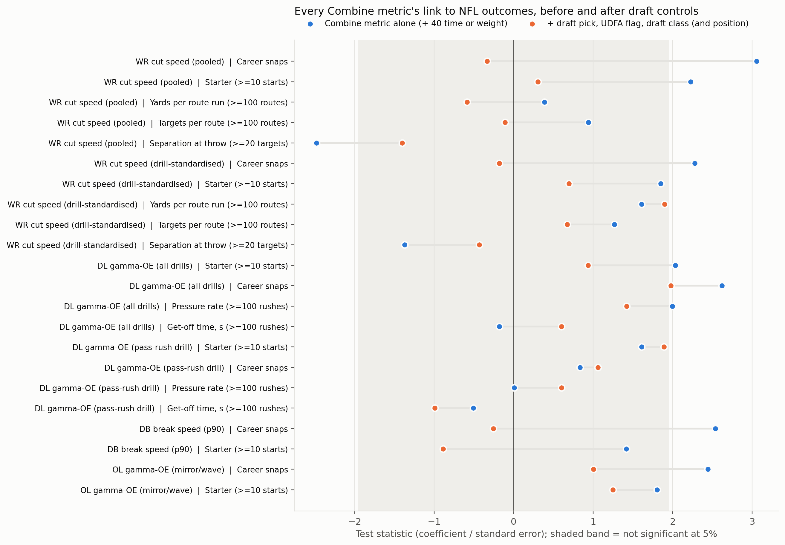
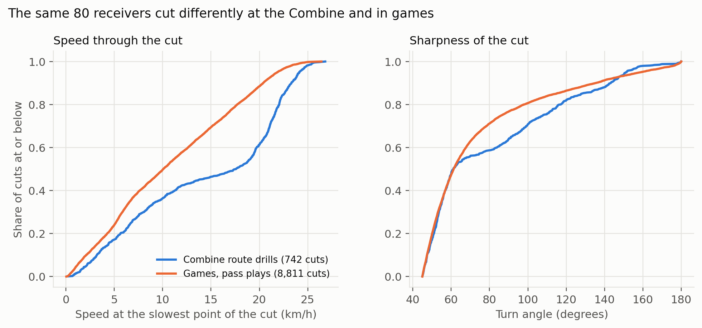
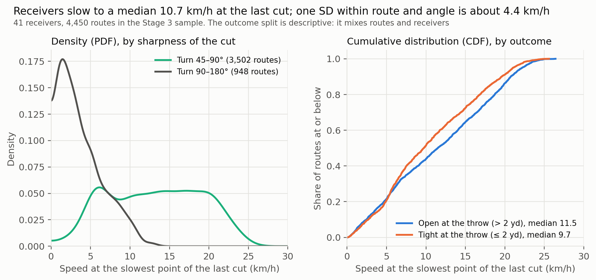
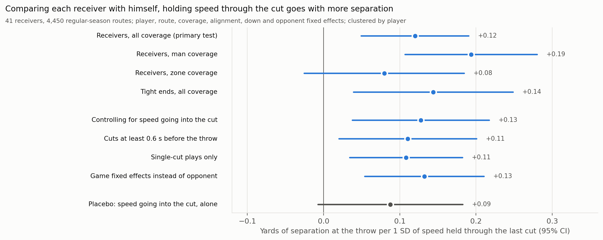
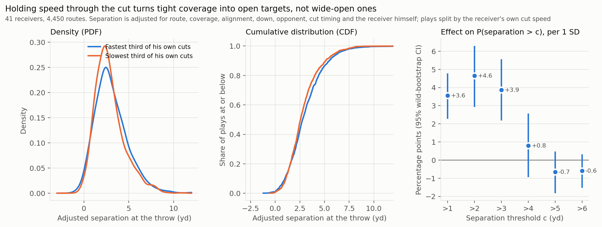
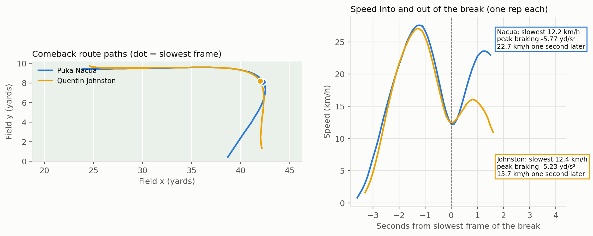
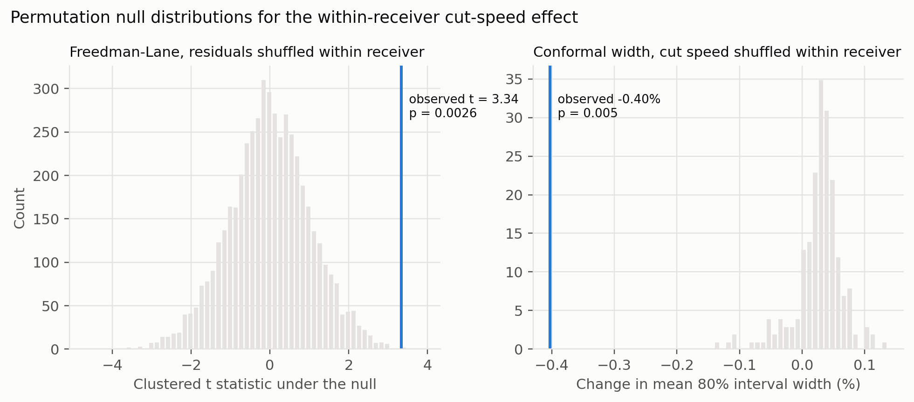

## 1. Introduction

Optical tracking at the NFL Scouting Combine records each prospect's position, speed and acceleration through every drill. Raw correlations suggest these profiles reveal ability that timed results miss: among 96 receivers with a 40-yard time, each additional km/h of median speed in cutting drills is associated with 114 more career snaps (p = 0.002).

That association does not answer the question a front office faces. Playing time is allocated largely by draft investment, and teams already observe athleticism when they draft (Massey and Thaler 2013). The Combine has long been found to predict performance only weakly (Kuzmits and Adams 2008). The relevant quantity is therefore a metric's predictive value **conditional on draft position**.

We show that the tracking metrics' value for playing time is explained by draft position, rank every predictor, and test two hypotheses about the cut in three pre-registered stages.

## 2. Data

The cohort comprises 510 prospects drafted or signed as undrafted free agents in 2023–2025.

* **Combine tracking:** 10 Hz position, speed and acceleration magnitude for each drill repetition.
* **Game tracking:** the same quantities for these players' NFL snaps.
* **Outcomes:** career snaps and starts through the 2025 season, and per-snap efficiency from play-level records. Efficiency uses regular-season rows only (249,269 of 314,197).

## 3. Methods

### 3.1 Draft-conditional models

Each metric–outcome pair is estimated twice: with the metric and its traditional covariate (40 time, or weight for linemen), and with draft controls added.

$$y_i = \beta_0 + \beta_1 m_i + \beta_2 c_i + \delta \log(\text{pick}_i) + \eta\,\text{UDFA}_i + \lambda_{\text{class}(i)} + \varepsilon_i$$

Undrafted players are coded as pick 262, and position fixed effects are added where positions are pooled. The estimators are:

* **Snaps:** ordinary least squares with heteroskedasticity-robust standard errors (White 1980).
* **Starter status** (10 or more starts): logit.
* **Rates:** fractional logit (Papke and Wooldridge 1996).
* **Snaps per season:** Poisson quasi-maximum likelihood.

Holm's (1979) correction is applied within each family of tests.

### 3.2 Metrics

**Receivers** are scored by median speed in the curl, comeback, speed-out and slant drills ($s_{\text{cut}}$), and by $z_{\text{cut}}$, standardised within drill.

**Linemen** are scored by $\gamma_{\text{OE}}$ (90th-percentile acceleration magnitude residualised on weight) and **defensive backs** by 90th-percentile transition-drill speed.

### 3.3 Change-of-direction measurement

Positions are smoothed with a seven-frame quadratic Savitzky–Golay filter (Savitzky and Golay 1964), which matches the provider's speed and acceleration columns (median per-repetition correlations 1.00 and 0.97). Its derivatives give velocity and acceleration vectors; acceleration splits into tangential (braking) and normal (turning) components, and horizontal force is $F = m\,a$.

A **cut** is the slowest frame of a run of frames turning at least 45° over ±0.5 s. Speed at the cut is z-scored within drill (or route) and turn-angle bin. Force is residualised on body mass.

This yields two hypotheses:

* **H1:** speed held through cuts, relative to peers, predicts performance.
* **H2:** force produced through cuts, relative to size, predicts performance.

Game cuts are measured identically, between the snap and the throw.

### 3.4 Designs and inference

Each stage was pre-registered before its outcomes were read (`results/*_preregistration.md`).

* **Stage 1** relates Combine cut metrics to careers under draft controls.
* **Stage 2** correlates each Combine metric with its in-game counterpart. It reports the maximum correlation attainable given both measures' split-half reliabilities (Spearman 1904).
* **Stage 3** regresses separation at the throw on the last cut's speed, play by play. It includes fixed effects for player, route, coverage type, receiver alignment, down and opponent × season, plus turn angle, cut timing, distance to go, cushion and dropback time. Errors are clustered by player; because 41 clusters is few, p-values and intervals come from a wild cluster bootstrap (Rademacher weights, 9,999 draws) and a Freedman–Lane permutation within receiver. Distribution regressions estimate effects on P(separation > c).

Stages 1 and 3 add CV+ conformal intervals (Barber et al. 2021) at 80% coverage with and without the metric, tested by shuffling the metric (within receiver in Stage 3). Stage 2 uses Spearman correlations with bootstrap intervals; Stage 1, HC3 and pairs-bootstrap intervals.

## 4. Results

### 4.1 Tracking metrics and playing time

Figure 1 and Table 1 show that every raw association is significant at 5% and none remains so with draft controls.

| Metric → outcome | Metric alone | With draft controls |
|:--|:-:|:-:|
| WR $s_{\text{cut}}$ → career snaps (per km/h) | +114, p = 0.002 | −10, p = 0.74 |
| WR $s_{\text{cut}}$ → starter (odds ratio) | 1.63, p = 0.026 | 1.11, p = 0.76 |
| DL $\gamma_{\text{OE}}$ → starter (odds ratio) | 1.85, p = 0.042 | 1.52, p = 0.35 |
| DB break speed → career snaps (per km/h) | +192, p = 0.011 | −15, p = 0.80 |
| OL $\gamma_{\text{OE}}$ → career snaps | +155, p = 0.015 | +58, p = 0.32 |

: Headline associations before and after draft controls. {#tbl-main}

Faster cutters are drafted earlier (p = 0.012); draft variables explain 51.1% of receiver snap variance, and cut speed and the 40 time add 0.2 points (Table 2).

| WR tier (career starts) | N | Mean $s_{\text{cut}}$ | Mean pick (UDFA = 262) | Undrafted |
|:--|:-:|:-:|:-:|:-:|
| Top (20+) | 14 | 18.03 km/h | 62 | 0% |
| Middle (3–19) | 40 | 17.19 km/h | 116 | 10% |
| Fringe (0–2) | 52 | 16.53 km/h | 184 | 50% |

: Receiver tiers by career starts. {#tbl-tiers}

The raw tier gap is large (Welch t = 4.75, p < 0.001), but half the fringe tier went undrafted. Of 22 controlled tests, none survives Holm correction. The confidence intervals distinguish two cases:

* **Effects ruled out:** for receiver snaps [−69, +49] and DB snaps [−130, +100], the intervals exclude the raw effects.
* **Inconclusive:** receiver and lineman starter odds and OL snaps, where the intervals are wide.

### 4.2 Predictor ranking

Table 3 ranks every predictor by cross-validated starter AUC and by efficiency rank correlation beyond draft pick.

| Outcome | 1st | 2nd | 3rd | Best tracking metric |
|:--|:--|:--|:--|:--|
| WR starter (AUC) | Draft pick 0.87 | NGS final 0.78 | NGS production 0.74 | Cut speed 0.69 |
| DL starter (AUC) | Draft pick 0.82 | NGS final 0.76 | NGS production 0.74 | Pass-rush $\gamma_{\text{OE}}$ 0.65 |
| DB starter (AUC) | Draft pick 0.90 | NGS final 0.81 | NGS production 0.76 | Break speed 0.63 |
| OL starter (AUC) | Draft pick 0.93 | NGS final 0.86 | NGS production 0.85 | $\gamma_{\text{OE}}$ 0.67 |
| WR yards per route, beyond pick | $z_{\text{cut}}$ +0.33 (p = 0.008) | NGS production +0.21 | NGS athleticism −0.19 | (1st) |
| DL pressure rate, beyond pick and position | NGS final +0.36 (p = 0.003) | 10-yard split −0.29 (p = 0.034) | Bench reps +0.29 | $\gamma_{\text{OE}}$ +0.24 |

: Predictors ranked by out-of-sample AUC (playing time) and partial rank correlation (efficiency). {#tbl-rank}

Draft pick ranks first everywhere and nothing adds more than 0.01 AUC to it; Combine information appears only in efficiency. Seven of 30 efficiency correlations fall below 0.05 (1.5 expected); none survives Holm.

### 4.3 Cut metrics at the Combine and their transfer to games

| Stage | Test | Result |
|:----|:-------|:----------|
| 1. Combine → career | Cut speed → yards per route run (N = 61) | +0.35 per SD, bootstrap [−0.16, +0.85], HC3 p = 0.21; conformal width −3.0% vs +2.6% for noise, p = 0.03 |
| | Force for size → snaps per season (N = 207) | +8.6% per SD, bootstrap [−4%, +23%], p = 0.17; no conformal gain |
| 2. Combine → game | Cut speed, Combine vs game (N = 59) | $\rho$ = +0.01 [−0.23, +0.24]; maximum attainable 0.35 |
| | Force for size (N = 145, partial on position) | $\rho$ = −0.18 [−0.35, −0.01]; maximum attainable 0.48 |
| 3. Within player | Cut speed → separation (4,450 routes) | +0.12 yd per SD, wild bootstrap [+0.05, +0.19], p = 0.003; conformal p = 0.005 |

: The three pre-registered stages. {#tbl-stages}

Neither Stage 1 primary test is significant (Table 4), and the Combine measures are unreliable:

* **Cut speed** correlates 0.58 between two repetitions of the same drill, but 0.03 between different drills.
* **Force relative to size** correlates 0.38 between repetitions.

In-game measures (166,150 cuts) reach split-half reliabilities of 0.61–0.97, and the Combine measures do not track them. The negative force correlation contradicts transfer; for cut speed, the ceiling of 0.35 limits what the null rules out.

Figure 2 suggests why: the same 80 receivers cut at similar angles in both settings (median 61°) but carry a median 17.6 km/h through Combine cuts against 10.0 km/h in games. Unopposed drills measure a different movement.

### 4.4 Within-player effects in games

Figure 3 shows the speed under test: a median 10.7 km/h at the last cut (interquartile range 5.5–16.8), 3.0 km/h on turns past 90°. One standard deviation within route and angle is about 4.4 km/h. Open receivers carry more (median 11.5 vs 9.7 km/h), a raw split that mixes routes and receivers.

Figure 4 reports Stage 3. Comparing each receiver with himself removes draft slot, talent, size and team. One standard deviation more speed through the last cut raises separation at the throw by 0.12 yards (wild-bootstrap p = 0.003; Freedman–Lane within-receiver p = 0.003).

The effect is concentrated where a cut must beat a defender:

* **Man coverage:** +0.19 yards [0.11, 0.28].
* **Zone coverage:** +0.08 yards [−0.03, 0.19].

It replicates for tight ends (+0.14), raises target probability by 3.0 points per SD, and holds with entry speed controlled (+0.13), for cuts at least 0.6 s before the throw (+0.11), on single-cut plays (+0.11) and with game fixed effects (+0.13). Entry speed alone, the placebo, is weaker (+0.09, p = 0.07).

Figure 5 shows where the gain sits. Each standard deviation raises the probability of more than 1, 2 and 3 yards of separation by 3.6, 4.6 and 3.9 percentage points (wild-bootstrap p $\le$ 0.001), but leaves more than 4 yards unchanged (+0.8 [−0.9, +2.6]). Holding speed turns tight coverage into open targets rather than creating wide-open ones.

H2 is not supported. Turning force alone does not predict separation (−0.01 yards per 100 N, p = 0.79). Holding speed fixed, greater turning force, implying a tighter turn, lowers separation (−0.11, p = 0.001).

## 5. Discussion

The Combine signal for playing time restates the draft board. The cut skill matters, but one Combine repetition per drill measures noise.

In Figure 6, Puka Nacua (pick 177, later an All-Pro) and Quentin Johnston (pick 21) enter one comeback break alike, yet one second later Nacua is at 22.7 km/h and Johnston at 15.7. That is the Stage 3 skill, but one repetition cannot rank prospects.

Four implications follow:

1. Test any metric conditional on draft position.
2. Do not scout cutting from Combine drills.
3. Measure speed through cuts from game or college tracking.
4. Keep timed short-area speed for pass rushers, where the 10-yard split predicts pressure rate beyond draft slot.

The 0.12-yard effect, about 6% of a standard deviation of separation, is small per play but accumulates over hundreds of routes.

## 6. Limitations

Careers span one to three seasons, and efficiency samples are small (57–69 players). Stage 3 removes player-level but not play-level confounding:

* **Play design:** a route may be called to beat a coverage.
* **Throw timing:** the quarterback times the throw on perceived openness.
* **The defender:** his movement is untracked.

Force is horizontal only, and the tracked point is not the centre of mass. The estimates are consistent with a causal effect, strongest against man coverage, but do not establish one.

## 7. Conclusion

Once draft position is known, Combine tracking metrics add no information about NFL playing time. Speed held through cuts does predict separation within a receiver's own plays, but Combine drills do not measure it. Cutting belongs in game tracking; the next step is a pre-registered 2026-class test of rookie-season cut speed against later yards per route run.

## References

Barber, R. F., Candès, E. J., Ramdas, A., and Tibshirani, R. J. (2021). Predictive inference with the jackknife+. *Annals of Statistics*, 49(1), 486–507.

Holm, S. (1979). A simple sequentially rejective multiple test procedure. *Scandinavian Journal of Statistics*, 6(2), 65–70.

Kuzmits, F. E., and Adams, A. J. (2008). The NFL Combine: Does it predict performance in the National Football League? *Journal of Strength and Conditioning Research*, 22(6), 1721–1727.

Massey, C., and Thaler, R. H. (2013). The loser's curse: Decision making and market efficiency in the National Football League draft. *Management Science*, 59(7), 1479–1495.

Papke, L. E., and Wooldridge, J. M. (1996). Econometric methods for fractional response variables with an application to 401(k) plan participation rates. *Journal of Applied Econometrics*, 11(6), 619–632.

Savitzky, A., and Golay, M. J. E. (1964). Smoothing and differentiation of data by simplified least squares procedures. *Analytical Chemistry*, 36(8), 1627–1639.

Spearman, C. (1904). The proof and measurement of association between two things. *American Journal of Psychology*, 15(1), 72–101.

White, H. (1980). A heteroskedasticity-consistent covariance matrix estimator and a direct test for heteroskedasticity. *Econometrica*, 48(4), 817–838.

## Appendix A. Permutation null distributions

Figure 7 shows the two permutation tests for Stage 3, both shuffling within receiver. Only 12 of 4,999 shuffles reach the observed |t| of 3.34, and none of 200 matches the observed conformal width change (−0.40%). Full output: `results/distribution_checks.txt`.

## Code and data availability

Every number is produced by the scripts in `scripts/`, with outputs and pre-registrations in `results/`; the README lists the run order. Competition data: NFL Big Data Bowl 2027 (Kaggle).
